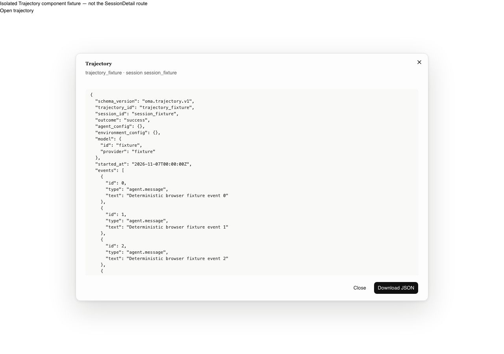
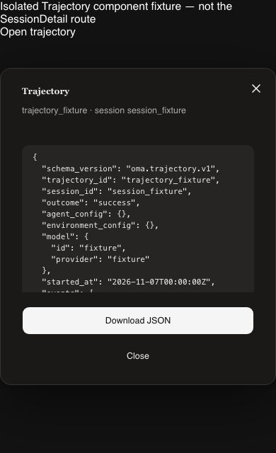
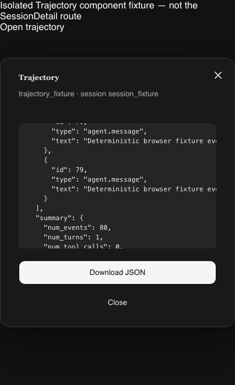
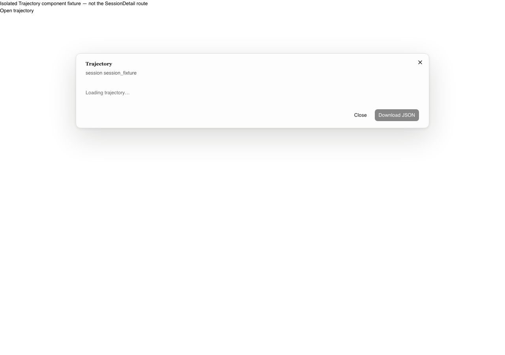
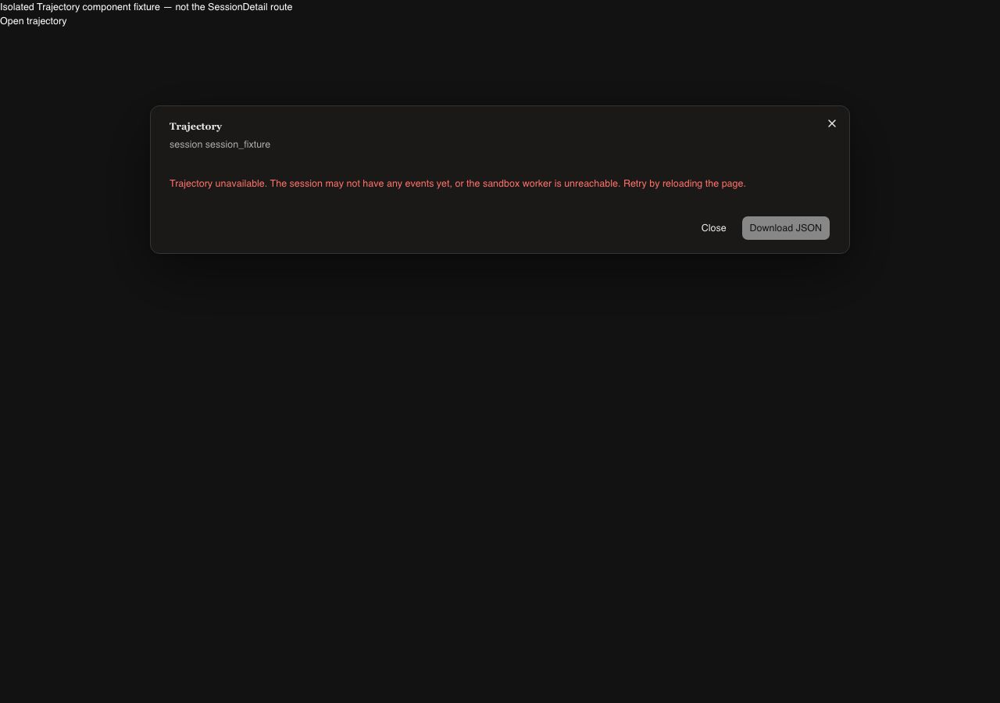
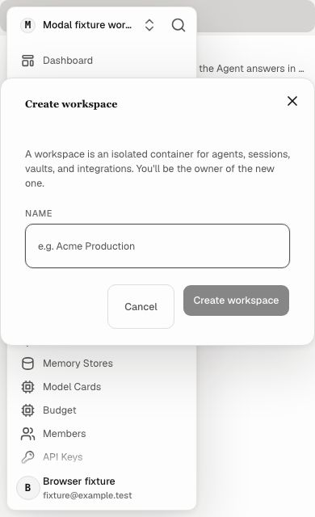
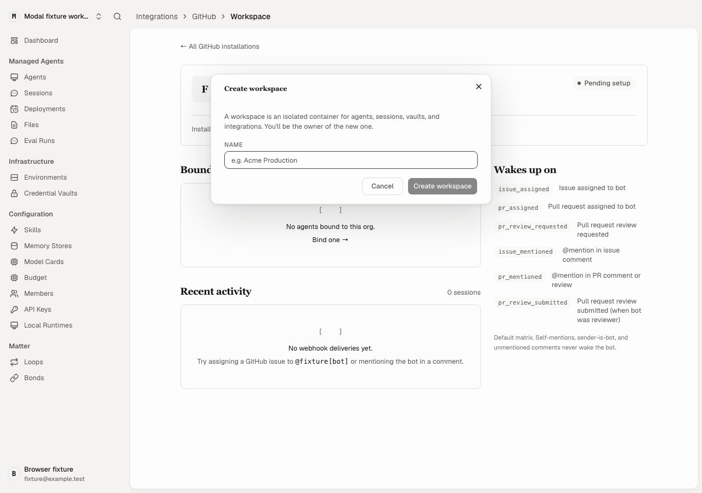
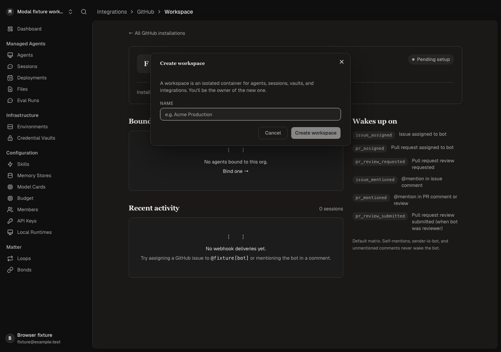

# Modal #506 follow-up acceptance evidence

PR #556 source head: `ba6b309653b506cc52613927fabc08ea46fb510e`.
Production code is unchanged from `e458cda2`; before production build is
`0d26903185e3fd8bb89c6499ae21f021e3a3b23e`.
Real Chromium browser rendering with intercepted API fixtures; **not a live backend**.

- [AST import closure and actual router inventory](closure-v2.json): direct Modal17 / Select9 / Input5 / Avatar6; recursive25/12/10/18.
- 42 shell router entries (40 concrete routes +2 redirects) in both themes; 104 cases per build. The configured new-loop form adds 6 cases. Every shell Modal opens and dismisses normally, including mobile sidebar entry. Route final URLs are retained.
- Six shell cases run mobile390×640 with root16px and20px; desktop1280×900. These preserve the original confirmation/long-form matrix in the parent evidence directory.
- The actual TrajectoryViewerModal opens/closes in a clearly labelled isolated fixture: ready/loading/error light/dark and ready mobile16px/20px; 10 cases and36 screenshots per build. Ready JSON downloads; long JSON scrolls. Exact production CSS and assets are used for each revision.
- **SessionDetail route remains unreachable for Trajectory**: normal click times out because button is disabled. Source initializes and only resets trajectory to undefined. The before/after route results include click diagnostics and request paths; no trajectory request occurs. No forced state, enabled button, or product edit was used. A separate loading-flow repair is required for route-level open coverage.
- Additional screenshots: **368 per build /736 total**. Measured geometry matches for all120 open/close cases per build. **360/368 image pairs byte-identical**, including every modal open and every Trajectory image. [Comparison](followup-comparison.json), [decoded differences](followup-pixel-differences.json).
- Seven image pairs have tiny JPEG differences (maximum mean channel difference0.00111/255; no pixels above8/255). One closed `/loops/new` screenshot has the existing two-pixel top navigation progress bar during redirect (2560 pixels above8/255; mean0.5089/255). Raw images are retained; no masking or product behavior changes.
- Initial fixture probes exposed missing package arrays, loop config, deployment agent and GitHub bot_login fields. Those fixture errors were corrected for both final production-build runs. Final matrices pass; probe failures are not reported as product bugs.
- Temporary three-way integration with #555 head`b1167b0959e130942615182e4386224663616693` merges token CSS cleanly. [Combined scanner](integration555-scan.log):108 root tokens,167 should-token=108CSS+56TSX+3inline. #556 alone remains170→170 and scoped0→0. No count reduction claimed for #556.
- #547 head`7896a8f76d1bc35052343765c7672c51ec255ba1` remains open. Gate integration must add this PR's `--modal-viewport-cap`, `--modal-confirmation-dim` plus #555's `--filter-chip-clear-w`, `--combobox-menu-min-w`, `--local-combobox-menu-max-h` to the allowlist via owner-approved token path. No #556 budget changes; #555 ratchets Combobox1→0 and console-list11→9. Other overlapping PRs need their own exact baseline reconciliation.
- Typecheck/build/444 console tests and old-head CI previously passed; this follow-up changes tests/docs only. Current-head CI is linked in PR #556. No deployment, live-backend, hosted-plugin or cross-browser certification. #506 stays open.

## Full capture archive

[Download all 736 screenshots, metrics, logs, and the complete linked index](all-captures.tar.gz).
Extract with `tar -xzf all-captures.tar.gz` in an empty directory, then read
`README.md`. Identical files use ordinary tar hardlinks to keep the download
small without altering image bytes. All JSON metrics and logs also remain
browsable here; selected before/after pairs follow.

| State | Before | After |
|---|---|---|
| trajectory-ready-light-1280-16-open |  |  |
| trajectory-ready-dark-390-20-open |  |  |
| trajectory-ready-dark-390-20-scrolled |  |  |
| trajectory-loading-light-1280-16-open |  |  |
| trajectory-error-dark-1280-16-open |  |  |
| shell-loops-new-configured-light-390-20-open |  |  |
| shell-integrations-github-installations-id-light-1280-16-open |  |  |
| shell-integrations-github-installations-id-dark-1280-16-open |  |  |

Archive SHA-256: `3f8d730bb6a7d47ac8b030c934aa7772e67fd0febaf683cff9f83a11a7a2a351`.
